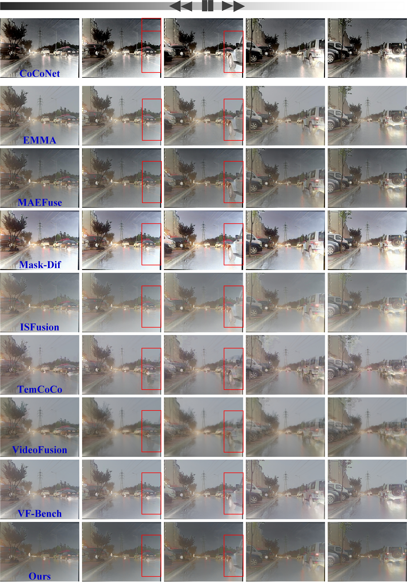

# UMVFuse
Toward Unified Multi-modal Image and Video Fusion via Dual-Teacher Prior Distillation

Some parts of the code are still being organized and refined, and the corresponding paper has not yet been officially published. Therefore, the complete implementation, documentation, and related materials will be released progressively rather than all at once. This repository will continue to be updated and improved as the publication process moves forward.

## 📎 Project & Resources

| Resource | Status | Link |
|--------|--------|------|
| 📄 Paper | Under Review |Coming Soon |
| 📊 Datasets | Released | See Dataset Release Status ↓ |
| 🔑 Code | Staged Rollout | See Code and Model Release Status ↓ |
| 💻 Performance | Staged Rollout | See Qualitative and Quantitative Release Status ↓ |

## 📊 Dataset Release Status

The BraST2020 sequence dataset is available in [this link](https://www.med.upenn.edu/cbica/brats2020/data.html) 

The test sequence of M3FD is available in [this link](https://pan.baidu.com/s/1ih94fQQql0BxU1RhaZphTQ?pwd=QWER) (Note: We manually constructed eight short sequences from temporally continuous image pairs)

The Polarization dataset is available in [this link](http://www.ok.sc.e.titech.ac.jp/res/PolarDem/index.html) 


## 🔑 Code and Model Release Status

### Training
The Fusion Stage

```bash
torchrun --nproc_per_node=2 main_fusepro.py    --checkpoint /path/to/pretrained_encoder.pth   --dataset_config_path options/fusion.yml
```

### Inference
```bash
python test_fuse.py   --checkpoint /path/to/fusion_checkpoint.pth   --dataset_config_path options/fusion.yml   --save_images --fuse_vi_y_channel
```

## 💻 Performance Release Status

### Qualitative comparison of different methods in scenarios with abrupt changes in local content.

  

### Visualization of inter-frame difference maps of the fused results produced by different methods in scenarios with large-scale and non-uniform motion.

  

Uncertainty-Guided Spatiotemporal Consistency Fusion Network for Infrared-Visible Video Fusion under Extremely Low-Light Conditions

## 📑 Citation

If you find our work useful for your research, please consider citing our paper:

```bibtex
@article{Huang2026UMVFuse,
  title   = {Toward Unified Multi-modal Image and Video Fusion via Dual-Teacher Prior Distillation},
  author  = {XXX, XXX, and XXX},
  journal = {Under Review},
  year    = {2026}
}

